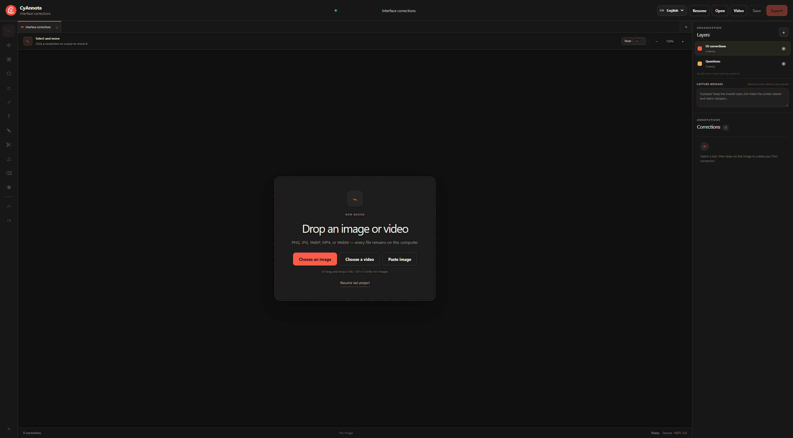

<table width="100%">
  <tr>
    <td width="300" align="left" valign="top">
      <a href="https://mrmybal.github.io/CyAnnota/">Ouvrir dans le navigateur</a><br>
      <a href="https://github.com/MrMybal/CyAnnota">Dépôt des sources</a><br>
      <a href="https://github.com/MrMybal/CyAnnota/issues">Signaler un problème</a><br><br>
      <sub>README</sub><br>
      <a href="README.md">English</a> · <a href="README.fr.md">Français</a>
    </td>
    <td width="400" align="center" valign="middle">
      <a href="https://mrmybal.github.io/CyAnnota/"></a>
    </td>
    <td width="300" align="right" valign="top">
      <p><sub>Licence de l’application</sub><br><a href="LICENSE"><strong>AGPL-3.0-only</strong></a></p>
      <p><sub>Version</sub><br><a href="VERSION.fr.md"><strong>CyAnnota 0.4.4</strong></a><br><strong>BÊTA</strong></p>
      <p><a href="https://github.com/MrMybal/CyAnnota/releases/download/v0.4.4/CyAnnota-0.4.4-setup.exe"><strong>Télécharger pour Windows</strong></a><br><sub>Windows x64 · installateur</sub><br><a href="https://github.com/MrMybal/CyAnnota/releases/download/v0.4.4/CyAnnota-0.4.4-portable.exe">Version portable</a></p>
    </td>
  </tr>
</table>

<h1 align="center">CyAnnota</h1>

Annotez des images, vidéos, GIF et modèles 3D pour expliquer les changements souhaités. CyAnnota permet de préparer des retours visuels, de revoir des captures et de partager des projets modifiables avec une équipe, une personne ou un outil d’IA. Il s’utilise dans le navigateur sans installation ou comme application Windows.

> **BÊTA · 0.4.4**
>
> CyAnnota est en cours de validation avant une version stable. Les fonctionnalités peuvent évoluer et des bugs peuvent survenir. Consultez les [notes de version et limites connues](VERSION.fr.md), notamment les différences entre le binaire Windows publié et l’édition en ligne.

<a id="aperçus"></a>
<a id="accueil-et-import-des-médias"></a>

[](docs/screenshots/01-home.png)

## À propos de CyAnnota

Ouvrez vos médias, marquez les zones à discuter et associez un message ou une image de référence à chaque correction. Ajoutez un message général pour une image ou tout l’espace de travail, et conservez plusieurs images, vidéos et modèles dans des onglets séparés. Le traitement des médias et les conversions s’effectuent localement sur votre ordinateur. L’édition en ligne télécharge l’application et les outils de traitement depuis son hébergement ; elle consulte GitHub pour rechercher les nouvelles versions.

Pour les vidéos et GIF, placez les annotations sur la timeline, déplacez-les ou faites glisser leur bord droit pour changer leur durée. Choisissez des arrêts sur image pour annoter et exporter des captures sélectionnées. Rognez le début et la fin d’une vidéo et encodez localement la partie conservée.

Pour les retours 3D, peignez des zones approximatives sur le mesh ou associez une demande à une vue caméra. Une session de peinture peut contenir plusieurs traits depuis différents points de vue avant sa validation. Les marquages expriment des demandes de modification, suppression, changement de couleur ou séparation ; ils n’effectuent pas ces retouches sur le mesh. Les caméras enregistrées sont exprimées relativement au modèle ou au mesh de référence.

**Sauver** crée un projet `.cyannota` réouvrable avec les médias sources. **Exporter** prépare un paquet adapté au destinataire : l’export Humain conserve les médias et les textes d’annotation sans fichiers de prompt ; l’export IA ajoute des prompts structurés dans la langue sélectionnée. L’export ZIP reste disponible. Dans l’édition en ligne, enregistrez les projets téléchargés pour conserver une copie transportable de votre travail.

<a id="fonctions-principales"></a>

## Fonctionnalités

- **Outils image** : cadres, formes, textes, flèches, dessin libre, demandes de suppression, pipette, demandes de couleur de remplacement, découpes rectangulaires/polygonales et redimensionnement d’une zone capturée.
- **Références et contexte** : images de référence associées aux corrections, regroupement d’éléments dans un cadre, messages par correction, par média et pour tout l’espace de travail.
- **Vidéo et GIF** : annotations temporelles, arrêts sur image, édition de timeline, rognage et export local GIF/MP4.
- **3D** : import GLB/glTF, conversion locale des fichiers FBX, OBJ et de la famille USD vers GLB, sessions de peinture avec effacement et annulation/validation, vues caméra enregistrées.
- **Affichage** : zoom et déplacement pour les images/vidéos ; orbite, déplacement et zoom en 3D, modes Texturé, Solide et Wireframe, bouton pour masquer les marquages.
- **Partage** : paquets `.cyannota` et ZIP multi-onglets, miniature et compteurs, optimisation facultative des images et inclusion facultative des vidéos originales dans les exports destinataires.
- **Presse-papiers Windows** : copie directe d’un ZIP ou copie après enregistrement d’un export ; numérotation automatique du nom pour éviter l’écrasement d’un fichier existant. Sur le Web, les possibilités dépendent du navigateur.
- **Intégrations** : éditeur embarqué, actions Envoyer/Fermer et retour d’une archive, de fichiers directs ou des deux. Des fonctions d’intégration permettent les aperçus et la lecture structurée des projets.
- **Langues** : anglais par défaut et français pour l’interface et les prompts générés.

---

## Installation

### Utiliser l’édition en ligne

1. [Ouvrez CyAnnota](https://mrmybal.github.io/CyAnnota/) dans un navigateur récent sur ordinateur.
2. Choisissez ou déposez une image, une vidéo, un GIF ou un modèle. Le collage d’images/vidéos/GIF dépend des données du presse-papiers exposées par le navigateur.
3. Annotez les médias, puis utilisez **Sauver** pour un projet modifiable ou **Exporter** pour un paquet à partager.

Aucune installation n’est nécessaire. Les exports utilisent les téléchargements du navigateur. Le traitement vidéo et l’affichage 3D dépendent des codecs du navigateur, de WebAssembly/WebGL et de la mémoire disponible. Consultez les [limites](VERSION.fr.md#limites-connues).

### Utiliser l’application Windows

1. Téléchargez l’[installateur 0.4.4](https://github.com/MrMybal/CyAnnota/releases/download/v0.4.4/CyAnnota-0.4.4-setup.exe) ou l’[exécutable portable 0.4.4](https://github.com/MrMybal/CyAnnota/releases/download/v0.4.4/CyAnnota-0.4.4-portable.exe).
2. Lancez l’installateur puis CyAnnota, ou exécutez directement la version portable.
3. Ouvrez vos médias ou un projet `.cyannota` existant. L’installateur associe cette extension à l’application.

Les versions de bureau publiées ciblent **Windows x64**. Node.js est nécessaire pour compiler les sources, pas pour utiliser ces exécutables. Les [fichiers de release et empreintes SHA-256](https://github.com/MrMybal/CyAnnota/releases/tag/v0.4.4) accompagnent les téléchargements.

<a id="développement"></a>

## Sources, compilation et bibliothèques nécessaires

<details>
<summary>Compiler ou lancer CyAnnota depuis les sources</summary>

Utilisez **Node.js 22.13 ou ultérieur**, npm et les dépendances verrouillées dans `package-lock.json`. Compilez les paquets Windows sur Windows.

```sh
git clone https://github.com/MrMybal/CyAnnota.git
cd CyAnnota
npm ci
npm run dev
```

Le serveur de développement affiche son adresse locale. Pour la compilation Web locale de production :

```sh
npm run build
npm start
```

Pour l’édition statique destinée au navigateur :

```sh
npm run pages:build
npm run pages:preview
```

La sortie est `dist/pages`, servie par l’aperçu sur `http://127.0.0.1:4175/CyAnnota/`. `CYANNOTA_PAGES_BASE` modifie le chemin `/CyAnnota/` par défaut. Le [workflow Pages](.github/workflows/pages.yml) publie les envois sur `main`, les releases publiées et les lancements manuels, avec un `source.zip` correspondant.

Pour le développement Electron et les paquets Windows :

```sh
npm run desktop:dev
npm run desktop:build
```

Les fichiers Windows sont produits dans `release/`. React fournit l’interface, Three.js l’affichage des modèles, JSZip les paquets de projet et FFmpeg WebAssembly la conversion vidéo locale. Vite/Vinext, Tailwind CSS, TypeScript et l’adaptateur de développement Cloudflare participent aux compilations. Les dépendances et leur périmètre sont indexés ci-dessous.

</details>

---

## Licence

**CyAnnota utilise la [GNU Affero General Public License v3.0 uniquement](LICENSE) (`AGPL-3.0-only`).** Copyright (C) 2026 CyberAlien.

Le [SDK d’intégration autonome](public/cyannota-integration.js) et le [SDK de création par IA](public/cyannota-ai.js) portent leurs propres notices MIT. Leur licence ne change pas la licence AGPL de l’application.

### Bibliothèques tierces

| Bibliothèque · sources | Licence · texte | Utilisation / périmètre |
| --- | --- | --- |
| [React / React DOM](https://github.com/facebook/react) | [MIT](https://github.com/facebook/react/blob/main/LICENSE) | Interface exécutée dans le navigateur et Electron. |
| [Three.js](https://github.com/mrdoob/three.js) | [MIT](https://github.com/mrdoob/three.js/blob/dev/LICENSE) | Affichage 3D, import des modèles et export GLB. |
| [JSZip](https://github.com/Stuk/jszip) | [MIT ou GPL-3.0-or-later](https://github.com/Stuk/jszip/blob/main/LICENSE.markdown) ; option MIT utilisée | Lecture et écriture des projets et archives ZIP. |
| [@ffmpeg/ffmpeg](https://github.com/ffmpegwasm/ffmpeg.wasm) | [MIT](https://github.com/ffmpegwasm/ffmpeg.wasm/blob/main/LICENSE) | Interface des workers de traitement vidéo, chargée au besoin. |
| [@ffmpeg/core 0.12.10](https://github.com/ffmpegwasm/ffmpeg.wasm) | [GPL-2.0-or-later](licenses/GPL-2.0.txt) · [notices des composants](THIRD_PARTY_NOTICES.md#traitement-vidéo) | Moteur multimédia WebAssembly de conversion locale ; ses composants gardent leurs conditions propres. |
| [Electron](https://github.com/electron/electron) | [MIT et notices Chromium incluses](https://github.com/electron/electron/blob/main/LICENSE) | Exécution de l’application Windows ; inutile pour l’édition navigateur hébergée. |
| [Next.js / eslint-config-next](https://github.com/vercel/next.js), [Vinext](https://github.com/cloudflare/vinext) | [MIT](licenses/MIT.txt) | Framework Web local et outils de compatibilité/compilation. |
| [Vite](https://github.com/vitejs/vite), [plugins React/RSC](https://github.com/vitejs/vite-plugin-react) | [MIT](licenses/MIT.txt) | Développement et compilation ; pas des prérequis séparés pour l’utilisateur final. |
| [Tailwind CSS / plugin PostCSS](https://github.com/tailwindlabs/tailwindcss) | [MIT](https://github.com/tailwindlabs/tailwindcss/blob/main/LICENSE) | Génération des feuilles de style à la compilation. |
| [TypeScript](https://github.com/microsoft/TypeScript) | [Apache-2.0](https://github.com/microsoft/TypeScript/blob/main/LICENSE.txt) | Vérification des types pendant le développement et la compilation. |
| [Types DefinitelyTyped](https://github.com/DefinitelyTyped/DefinitelyTyped) | [MIT](https://github.com/DefinitelyTyped/DefinitelyTyped/blob/master/LICENSE) | Types de développement Node.js, React/DOM et Three.js ; aucune exécution applicative. |
| [ESLint](https://github.com/eslint/eslint) | [MIT](https://github.com/eslint/eslint/blob/main/LICENSE) | Vérifications de code pendant le développement uniquement. |
| [react-server-dom-webpack](https://github.com/facebook/react) | [MIT](https://github.com/facebook/react/blob/main/LICENSE) | Outillage des composants serveur de la version Web locale. |
| [electron-builder](https://github.com/electron-userland/electron-builder) | [MIT](https://github.com/electron-userland/electron-builder/blob/master/LICENSE) | Création de l’installateur et de la version portable Windows. |
| [Plugin Vite Cloudflare](https://github.com/cloudflare/workers-sdk) | [MIT](licenses/MIT.txt) | Adaptateur utilisé par la compilation Web locale. |
| [Wrangler](https://github.com/cloudflare/workers-sdk), [types Workers](https://github.com/cloudflare/workerd) | MIT ou Apache-2.0, selon les déclarations des paquets | Outils de développement/compilation locaux et types ; aucun compte Cloudflare n’est nécessaire pour utiliser CyAnnota. |

Ce tableau indexe les principales dépendances directes, pas tous les composants transitifs. Conservez les [notices tierces complètes](THIRD_PARTY_NOTICES.md), les [textes de licence distribués](licenses/) et les crédits Electron/Chromium avec les distributions. Le fichier de verrouillage contient les versions exactes des dépendances.

## Références et liens

- [Application en ligne](https://mrmybal.github.io/CyAnnota/) · [Sources correspondant à l’édition en ligne](https://mrmybal.github.io/CyAnnota/source.zip).
- [Notes de version](VERSION.fr.md) · [Release Windows](https://github.com/MrMybal/CyAnnota/releases/tag/v0.4.4) · [Suivi des problèmes](https://github.com/MrMybal/CyAnnota/issues).
- [Dépôt des sources](https://github.com/MrMybal/CyAnnota) · [Guide d’intégration](integrations/README.md).
- [Guide de création structurée](integrations/AI_AUTHORING.md) · [Schéma JSON](integrations/cyannota-ai.schema.json) · [Contrat d’intégration TypeScript](integrations/cyannota-integration.d.ts).
