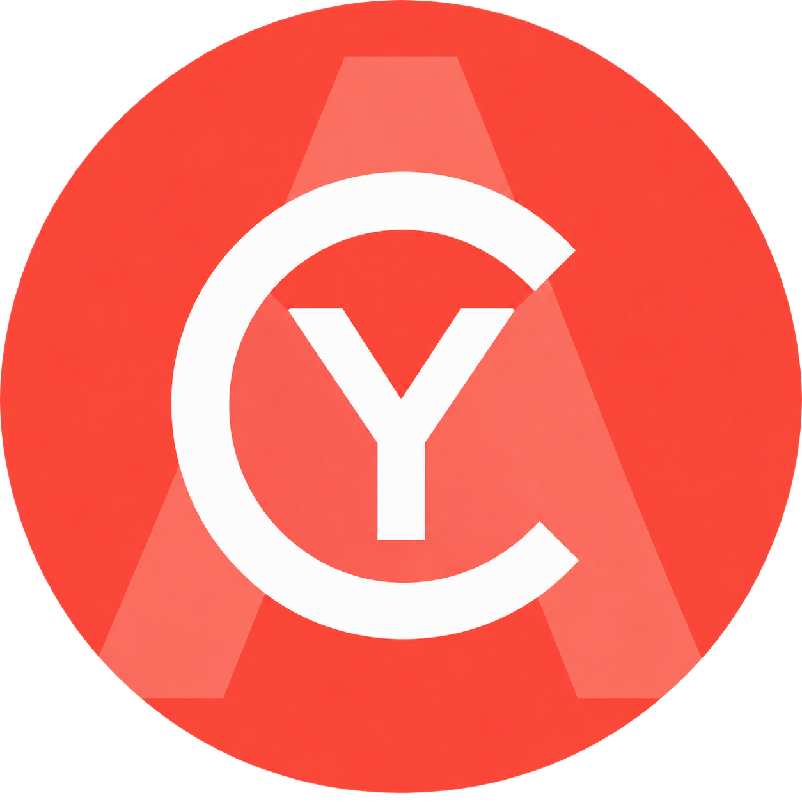
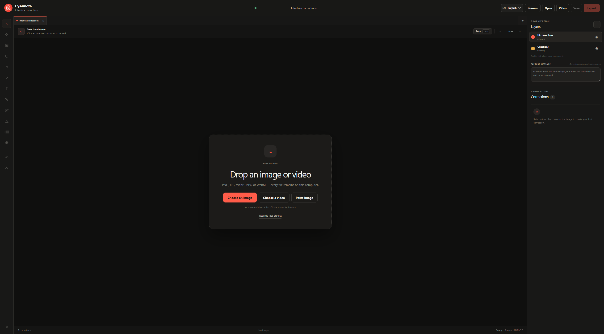

<table width="100%">
  <tr>
    <td width="300" align="left" valign="top">
      <a href="https://mrmybal.github.io/CyAnnota/">Open in your browser</a><br>
      <a href="https://github.com/MrMybal/CyAnnota">Source repository</a><br>
      <a href="https://github.com/MrMybal/CyAnnota/issues">Report an issue</a><br><br>
      <sub>README</sub><br>
      <a href="README.md">English</a> · <a href="README.fr.md">Français</a>
    </td>
    <td width="400" align="center" valign="middle">
      <a href="https://mrmybal.github.io/CyAnnota/"></a>
    </td>
    <td width="300" align="right" valign="top">
      <p><sub>Application license</sub><br><a href="LICENSE"><strong>AGPL-3.0-only</strong></a></p>
      <p><sub>Version</sub><br><a href="VERSION.md"><strong>CyAnnota 0.4.4</strong></a><br><strong>BETA</strong></p>
      <p><a href="https://github.com/MrMybal/CyAnnota/releases/download/v0.4.4/CyAnnota-0.4.4-setup.exe"><strong>Download for Windows</strong></a><br><sub>Windows x64 · installer</sub><br><a href="https://github.com/MrMybal/CyAnnota/releases/download/v0.4.4/CyAnnota-0.4.4-portable.exe">Portable version</a></p>
    </td>
  </tr>
</table>

<h1 align="center">CyAnnota</h1>

Annotate images, videos, GIFs and 3D models to explain what should change. CyAnnota helps individuals and teams prepare visual feedback, review captures and share editable projects with people or AI tools. Use it in a browser without installation or as a Windows application.

> **BETA · 0.4.4**
>
> CyAnnota is being validated before a stable release. Features may change and bugs may occur. Read the [version notes and known limitations](VERSION.md), including the differences between the published Windows build and the online edition.

<a id="aperçus"></a>
<a id="preview"></a>
<a id="accueil-et-import-des-médias"></a>
<a id="home-screen-and-media-import"></a>

[](docs/screenshots/01-home.png)

## About CyAnnota

Open your media, mark the areas you want to discuss and attach a message or reference image to each correction. Add a general message for one image or the whole workspace, and keep several images, videos and models in separate tabs. Media processing and conversions run locally on your computer. The online edition downloads the application and processing tools from its host; it checks GitHub for available releases.

For video and GIF feedback, place annotations on the timeline, move them or drag their right edge to adjust duration. Choose frame stops when you want to annotate and export selected still images. Trim the start and end of a video and encode the retained part locally.

For 3D feedback, paint approximate areas on the mesh or attach a request to a camera view. A paint session can contain several strokes from different viewpoints before you validate it. Marks express requests to modify, remove, recolor or separate a region; they do not perform those mesh edits. Saved cameras are expressed relative to the model or reference mesh.

**Save** creates a reopenable `.cyannota` project with source media. **Export** prepares a package for the recipient: Human exports keep the media and annotation text without prompt files; AI exports add structured prompts in the selected language. ZIP export remains available. In the online edition, save downloaded projects to keep a portable copy of your work.

<a id="fonctions-principales"></a>
<a id="main-features"></a>

## Features

- **Image tools:** frames, shapes, text, arrows, freehand marks, deletion requests, color sampling, replacement-color requests, rectangular/polygonal cutouts and resizing of a captured region.
- **References and context:** attach reference images to corrections, group elements in a frame, and write messages for a correction, media item or whole workspace.
- **Video and GIF:** timed annotations, frame stops, timeline editing, trimming and local GIF/MP4 export.
- **3D:** GLB/glTF import, local conversion of FBX, OBJ and USD-family files to GLB, paint sessions with erasing and cancel/validate controls, and saved camera views.
- **Viewer controls:** zoom and pan for images/video; orbit, pan and zoom for 3D, with Textured, Solid and Wireframe views and a toggle to hide annotation marks.
- **Sharing:** multi-tab `.cyannota` and ZIP packages, thumbnails and counts, optional image optimization and optional inclusion of original videos in delivery exports.
- **Windows clipboard:** copy a ZIP directly or copy an export after saving; automatic filename numbering avoids overwriting an existing file. Web clipboard support depends on the browser.
- **Integrations:** embed the editor in a host application, use Send/Close actions and retrieve an archive, direct files or both. Integration helpers support project previews and structured reading.
- **Languages:** English by default, with French available for the interface and generated prompts.

---

## Installation

### Use the online edition

1. [Open CyAnnota](https://mrmybal.github.io/CyAnnota/) in a recent desktop browser.
2. Choose or drop an image, video, GIF or model. Image/video/GIF paste support depends on the clipboard data exposed by your browser.
3. Annotate your media, then **Save** an editable project or **Export** a package to share.

No installation is required. Exports use browser downloads. Video processing and 3D rendering depend on the browser's codecs, WebAssembly/WebGL support and available memory. See the [limitations](VERSION.md#known-limitations).

### Use the Windows application

1. Download the [0.4.4 installer](https://github.com/MrMybal/CyAnnota/releases/download/v0.4.4/CyAnnota-0.4.4-setup.exe) or the [0.4.4 portable executable](https://github.com/MrMybal/CyAnnota/releases/download/v0.4.4/CyAnnota-0.4.4-portable.exe).
2. Run the installer and launch CyAnnota, or run the portable executable directly.
3. Open your media or an existing `.cyannota` project. The installer registers the project file association.

Published desktop builds target **Windows x64**. Node.js is needed to build from source, not to use these executables. [Release assets and SHA-256 checksums](https://github.com/MrMybal/CyAnnota/releases/tag/v0.4.4) accompany the downloads.

<a id="développement"></a>
<a id="development"></a>

## Source, build and required libraries

<details>
<summary>Build or run CyAnnota from source</summary>

Use **Node.js 22.13 or later**, npm and the dependencies pinned in `package-lock.json`. Build Windows packages on Windows.

```sh
git clone https://github.com/MrMybal/CyAnnota.git
cd CyAnnota
npm ci
npm run dev
```

The development server prints its local address. For the local Web production build:

```sh
npm run build
npm start
```

For the static browser edition:

```sh
npm run pages:build
npm run pages:preview
```

The output is `dist/pages`, served by the preview at `http://127.0.0.1:4175/CyAnnota/`. `CYANNOTA_PAGES_BASE` changes the default `/CyAnnota/` path. The [Pages workflow](.github/workflows/pages.yml) deploys pushes to `main`, published releases and manual runs, and includes a matching `source.zip`.

For Electron development and Windows packaging:

```sh
npm run desktop:dev
npm run desktop:build
```

Windows artifacts are written to `release/`. React provides the interface, Three.js the model viewer, JSZip project packaging and FFmpeg WebAssembly local video conversion. Vite/Vinext, Tailwind CSS, TypeScript and the Cloudflare development adapter support the builds. Dependencies and their scope are indexed below.

</details>

---

<a id="licence"></a>

## License

**CyAnnota uses the [GNU Affero General Public License v3.0 only](LICENSE) (`AGPL-3.0-only`).** Copyright (C) 2026 CyberAlien.

The standalone [integration SDK](public/cyannota-integration.js) and [AI authoring SDK](public/cyannota-ai.js) carry their own MIT notices. Their license does not change the application's AGPL license.

### Third-party libraries

| Library · source | License · terms | Use / scope |
| --- | --- | --- |
| [React / React DOM](https://github.com/facebook/react) | [MIT](https://github.com/facebook/react/blob/main/LICENSE) | Interface runtime in the browser and Electron. |
| [Three.js](https://github.com/mrdoob/three.js) | [MIT](https://github.com/mrdoob/three.js/blob/dev/LICENSE) | 3D rendering, model import and GLB export. |
| [JSZip](https://github.com/Stuk/jszip) | [MIT or GPL-3.0-or-later](https://github.com/Stuk/jszip/blob/main/LICENSE.markdown); used under MIT | Project and ZIP archive reading/writing. |
| [@ffmpeg/ffmpeg](https://github.com/ffmpegwasm/ffmpeg.wasm) | [MIT](https://github.com/ffmpegwasm/ffmpeg.wasm/blob/main/LICENSE) | Browser worker interface for video processing, loaded when needed. |
| [@ffmpeg/core 0.12.10](https://github.com/ffmpegwasm/ffmpeg.wasm) | [GPL-2.0-or-later](licenses/GPL-2.0.txt) · [component notices](THIRD_PARTY_NOTICES.md#traitement-vidéo) | WebAssembly media engine for local conversion; its components retain their own terms. |
| [Electron](https://github.com/electron/electron) | [MIT and bundled Chromium notices](https://github.com/electron/electron/blob/main/LICENSE) | Windows application runtime; not required by the hosted browser edition. |
| [Next.js / eslint-config-next](https://github.com/vercel/next.js), [Vinext](https://github.com/cloudflare/vinext) | [MIT](licenses/MIT.txt) | Local Web application framework and compatibility/build tooling. |
| [Vite](https://github.com/vitejs/vite), [React/RSC plugins](https://github.com/vitejs/vite-plugin-react) | [MIT](licenses/MIT.txt) | Development and bundling; not separate installed-user requirements. |
| [Tailwind CSS / PostCSS plugin](https://github.com/tailwindlabs/tailwindcss) | [MIT](https://github.com/tailwindlabs/tailwindcss/blob/main/LICENSE) | Build-time stylesheet generation. |
| [TypeScript](https://github.com/microsoft/TypeScript) | [Apache-2.0](https://github.com/microsoft/TypeScript/blob/main/LICENSE.txt) | Build/development type checking. |
| [DefinitelyTyped types](https://github.com/DefinitelyTyped/DefinitelyTyped) | [MIT](https://github.com/DefinitelyTyped/DefinitelyTyped/blob/master/LICENSE) | Development types for Node.js, React/DOM and Three.js; no runtime. |
| [ESLint](https://github.com/eslint/eslint) | [MIT](https://github.com/eslint/eslint/blob/main/LICENSE) | Development-only code checks. |
| [react-server-dom-webpack](https://github.com/facebook/react) | [MIT](https://github.com/facebook/react/blob/main/LICENSE) | Local Web server-component tooling. |
| [electron-builder](https://github.com/electron-userland/electron-builder) | [MIT](https://github.com/electron-userland/electron-builder/blob/master/LICENSE) | Windows installer and portable packaging. |
| [Cloudflare Vite plugin](https://github.com/cloudflare/workers-sdk) | [MIT](licenses/MIT.txt) | Adapter used by the local Web build. |
| [Wrangler](https://github.com/cloudflare/workers-sdk), [Workers types](https://github.com/cloudflare/workerd) | MIT or Apache-2.0, as declared by the packages | Local development/build tooling and types; no Cloudflare account is required to use CyAnnota. |

This table indexes the main direct dependencies, not all transitive components. Keep the full [third-party notices](THIRD_PARTY_NOTICES.md), [distributed license texts](licenses/) and Electron/Chromium credits with distributions. The lockfile records exact dependency versions.

## References and links

- [Online application](https://mrmybal.github.io/CyAnnota/) · [Online edition's corresponding source](https://mrmybal.github.io/CyAnnota/source.zip).
- [Version notes](VERSION.md) · [Windows release](https://github.com/MrMybal/CyAnnota/releases/tag/v0.4.4) · [Issue tracker](https://github.com/MrMybal/CyAnnota/issues).
- [Source repository](https://github.com/MrMybal/CyAnnota) · [Integration guide](integrations/README.md).
- [Structured authoring guide](integrations/AI_AUTHORING.md) · [JSON schema](integrations/cyannota-ai.schema.json) · [TypeScript integration contract](integrations/cyannota-integration.d.ts).
