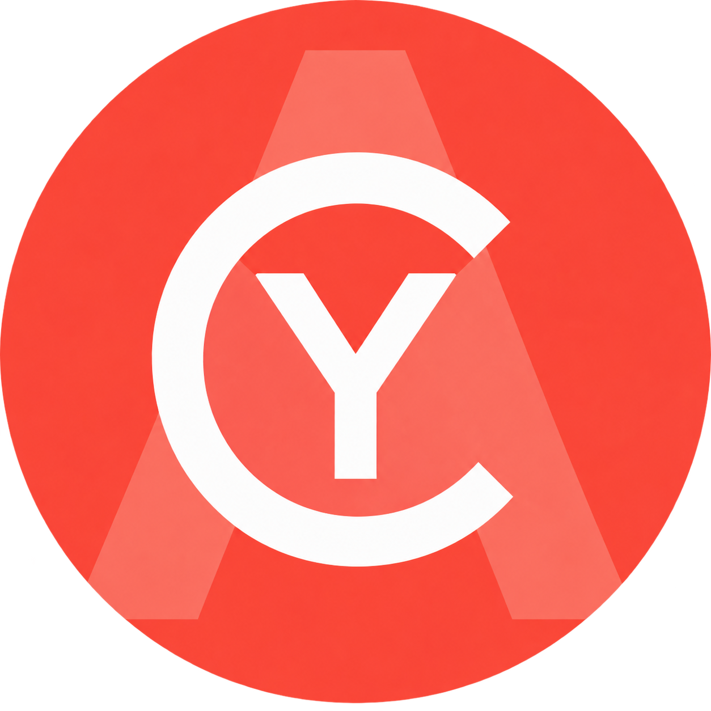
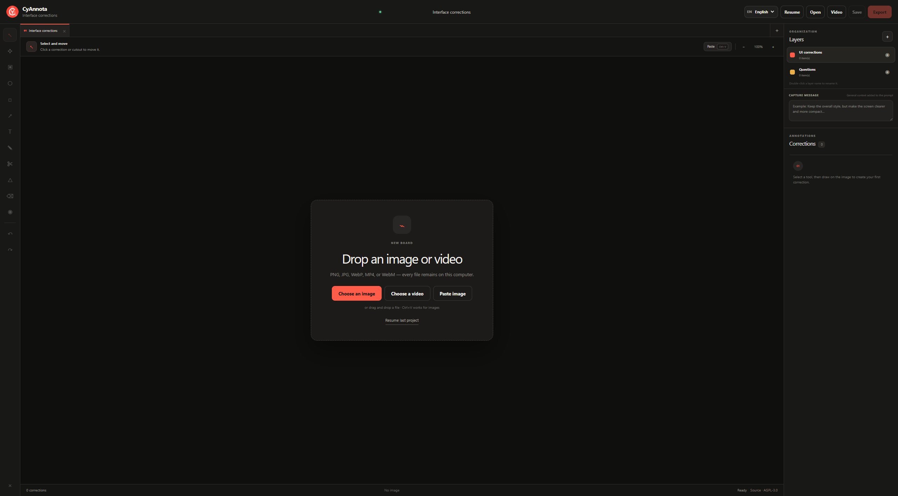

# CyAnnota

**English** · [Français](README.fr.md)

<p align="center"></p>

CyAnnota is a local annotation tool for images, videos and 3D models. Prepare visual feedback, collaborate with a team, create freeze frames, paint guidance on meshes, and export annotations for a person or an AI in reusable `.cyannota` projects.

> **Beta:** CyAnnota is still under development. Some features may change or contain bugs.

[Open CyAnnota in your browser, without installation](https://mrmybal.github.io/CyAnnota/) · [Download the Windows version](https://github.com/MrMybal/CyAnnota/releases/latest)

The online version runs in your browser: imported media and conversions stay on your computer. Save your `.cyannota` projects to keep them and reopen them in the Web or Windows version. Web exports use browser downloads; copying a ZIP to the clipboard depends on the formats allowed by the browser. A recent desktop browser is recommended for videos and 3D models.

<a id="aperçus"></a>

## Preview

<a id="accueil-et-import-des-médias"></a>

### Home screen and media import



<a id="fonctions-principales"></a>

## Main features

- Image annotations with frames, shapes, text, colors, deletion and cropping.
- Time-based video and GIF annotations with precise freeze frames.
- 3D annotations painted as guidance on a mesh: edit, delete, recolor or split them.
- GLB/glTF import and local conversion of FBX, OBJ, USD, USDA, USDC and USDZ to GLB, without uploading to a server.
- Camera views saved relative to the model or annotated mesh, with screenshots included in the project.
- Import images, videos and GIFs through a file picker, drag and drop or `Ctrl+V`.
- Zoom and pan in a canvas-style workspace.
- Save multiple media items in a `.cyannota` project.
- Human exports without prompts, and AI exports with structured prompts.
- GIF or MP4 export, local WebP image optimization, copying exported files to the clipboard, and automatic renaming without overwriting.
- Local integration with CyTask, CyCapture, CyAIOrchestrator and Web applications: embedded editor, direct sending, package reading and thumbnails.
- AI authoring SDK to create or edit `.cyannota` projects with structured spatial and temporal annotations.
- Local Web application and Windows Electron application.
- English or French interface and prompts, with English as the default.

`.blend` files require Blender and must be exported to GLB before importing into CyAnnota.

<a id="développement"></a>

## Development

Requirement: Node.js 22.13 or newer.

```bash
npm install
npm run dev
```

Web build:

```bash
npm run build
```

Windows portable and installer builds:

```bash
npm run desktop:build
```

Static build for GitHub Pages, separate from local and Windows builds:

```bash
npm run pages:build
npm run pages:preview
```

Output is written to `dist/pages`. By default it uses the `/CyAnnota/` base path; set `CYANNOTA_PAGES_BASE` to use another path. The `.github/workflows/pages.yml` workflow builds and publishes the site on pushes to `main`, releases or manual runs. The deployment also provides `source.zip`, containing the source code corresponding to the published Web version. In the repository's GitHub Pages settings, the source must be **GitHub Actions**.

The integration contract is documented in [`integrations/README.md`](integrations/README.md).

<a id="licence"></a>

## License

Copyright (C) 2026 CyberAlien.

CyAnnota is distributed under the **GNU Affero General Public License v3.0 only** (`AGPL-3.0-only`). See [`LICENSE`](LICENSE).

The standalone SDK [`public/cyannota-integration.js`](public/cyannota-integration.js) is distributed separately under the MIT license to allow integration into other software and websites.

Third-party components retain their own licenses. See [`THIRD_PARTY_NOTICES.md`](THIRD_PARTY_NOTICES.md), including the notices for FFmpeg and `@ffmpeg/core`.
